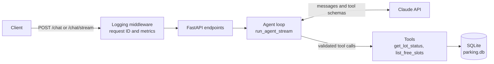

# Parking Ops Agent

A tool-calling AI agent that answers questions about parking lot occupancy ("How full is Lot A?", "Which slots are free in Lot B?"). The agent loop is built by hand, without an agent framework, and served as a containerized FastAPI service with SSE streaming, request tracing, and tiered error handling.

Built as a learning project to practice production-style agent engineering: tool calling, validation, failure handling, observability, and deployment.

## Features

- **Hand-built agent loop** on the Anthropic Messages API, with a step cap so a misbehaving model cannot loop forever.
- **Narrow, purpose-built tools** (`get_lot_status`, `list_free_slots`) instead of free-form SQL, so the model cannot run arbitrary queries.
- **Schema-validated tool calls**: tool names and arguments are checked against JSON Schema before anything runs.
- **Tiered error handling**: expected failures go back to the model, infrastructure failures abort the run with a safe message.
- **Two HTTP interfaces**: `POST /chat` (JSON) and `POST /chat/stream` (Server-Sent Events).
- **Request tracing**: every request gets an ID, returned in `X-Request-ID` and attached to every log line.
- **Structured completion log** per request: latency, steps, token usage, tools called, outcome.
- **Container image** that runs as a non-root user with a health check.

## Architecture



The loop in `agent.py` works like this:

1. Send the conversation and tool definitions to the model (streamed).
2. If the model stops with `tool_use`, validate each requested call, execute it, and append a `tool_result` (with `is_error: true` for expected failures).
3. Repeat until the model finishes (`end_turn`) or the step cap is reached.

`run_agent` (used by the CLI and `/chat`) is a thin wrapper that consumes the same generator that powers `/chat/stream`, so there is a single loop to maintain.

## Project layout

| Path | Purpose |
|---|---|
| `agent.py` | Agent loop, tool definitions, validation, event and result models, CLI |
| `tools.py` | Tool implementations and the `ToolError` exception hierarchy |
| `api.py` | FastAPI app, SSE endpoint, error handlers, request-logging middleware |
| `request_context.py` | Request ID and per-request metrics (context variables), log filter |
| `seed.py` | Creates `parking.db` with reproducible synthetic data |
| `Dockerfile`, `.dockerignore` | Container build |
| `requirements.txt` | Pinned runtime dependencies |
| `requirements-dev.txt` | Runtime dependencies plus development tools |
| `experiments/` | Scratch scripts, including the sync vs async benchmark |

## Getting started

### Prerequisites

- Python 3.11 or newer (developed on 3.12)
- An Anthropic API key

### Install

Windows PowerShell:

```powershell
git clone https://github.com/MuhanadKR/parking-agent.git
cd parking-agent
python -m venv .venv
.venv\Scripts\Activate.ps1
python -m pip install -r requirements-dev.txt
```

macOS or Linux:

```bash
git clone https://github.com/MuhanadKR/parking-agent.git
cd parking-agent
python -m venv .venv
source .venv/bin/activate
python -m pip install -r requirements-dev.txt
```

### Configure

Set your API key for the current terminal session. Never commit it.

```powershell
# PowerShell (prompts, so the key stays out of your shell history)
$env:ANTHROPIC_API_KEY = Read-Host "Paste API key"
```

```bash
# macOS or Linux
export ANTHROPIC_API_KEY="your-key"
```

Logs go to stdout by default. To also write them to a file, set `LOG_FILE`:

```powershell
$env:LOG_FILE = "agent.log"
```

### Seed the demo database

```
python seed.py
```

This creates `parking.db` with two lots (`A` with 20 slots, `B` with 12 slots) and 24 hourly readings per slot. The random generator is seeded, so the data is reproducible. The readings are synthetic and static.

### Run

Interactive CLI:

```
python agent.py
```

HTTP API:

```
python -m uvicorn api:app --reload
```

Interactive API docs are served at `http://127.0.0.1:8000/docs`.

### Run with Docker

```
docker build -t parking-agent .
docker run --rm -p 8000:8000 -e ANTHROPIC_API_KEY parking-agent
```

Passing `-e ANTHROPIC_API_KEY` without a value copies the variable from your current environment, so the key never appears in the command or in the image. The demo database is created at build time and is read-only inside the image.

## API

### `GET /health`

Returns `{"status": "ok"}`. It checks only that the process is up, not the upstream API.

### `POST /chat`

Request:

```json
{ "question": "How full is Lot A?" }
```

`question` must be 1 to 2000 characters and not blank.

Response:

```json
{
  "answer": "Lot A has 20 slots. 10 are occupied and 10 are free, so it's half full.",
  "tool_calls": [
    { "name": "get_lot_status", "input": { "lot_id": "A" }, "is_error": false }
  ],
  "steps": 2,
  "stop_reason": "end_turn",
  "input_tokens": 1946,
  "output_tokens": 117
}
```

`steps` counts model calls. Token counts are summed across the whole run.

PowerShell:

```powershell
Invoke-RestMethod -Method Post -Uri http://127.0.0.1:8000/chat `
  -ContentType "application/json" `
  -Body '{"question":"How full is Lot A?"}'
```

curl:

```bash
curl -X POST http://127.0.0.1:8000/chat \
  -H "Content-Type: application/json" \
  -d '{"question":"How full is Lot A?"}'
```

### `POST /chat/stream`

Same request body. The response is `text/event-stream`. Each event is sent as `event: <type>` followed by a JSON `data:` line.

| Event | Meaning |
|---|---|
| `tool_start` | The agent is about to run a tool (`name`) |
| `tool_end` | The tool finished (`name`, `is_error`) |
| `text` | A chunk of model text (`chunk`). Concatenate chunks exactly as received. |
| `done` | The run finished. Carries the final result in the same shape as `/chat`. |
| `error` | The run failed after streaming began. Carries a safe `error` message and the `request_id`. |

```bash
curl -N -X POST http://127.0.0.1:8000/chat/stream \
  -H "Content-Type: application/json" \
  -d '{"question":"How full is Lot A?"}'
```

Once a stream has started, the HTTP status is already `200`, so a failure arrives as an `error` event instead of a status code. A stream that ends without a `done` event should be treated as incomplete.

### Errors

Failures return a consistent body and never include exception text:

```json
{ "error": "Service temporarily unavailable. Please try again later.", "request_id": "..." }
```

| Status | Cause |
|---|---|
| 422 | Invalid request body |
| 502 | Upstream authentication failure (a server configuration problem, not the caller's) |
| 503 | Upstream rate limit or connection failure after SDK retries |
| 500 | Any other unexpected failure |

Every response carries an `X-Request-ID` header. Quote it when reporting a problem; it ties the response to the logs.

## Design decisions

**Hand-built loop.** The loop is about 100 lines on purpose, so the mechanics (stop reasons, tool results, message ordering) are visible. A framework would hide exactly what is worth understanding.

**Narrow tools instead of `run_sql`.** The model cannot read other tables, write, or craft a harmful query. The trade-off is that each new question type needs a new tool. All queries use parameterized SQL and a read-only connection.

**Three error tiers.**

| Tier | Examples | Behavior |
|---|---|---|
| Model-visible | Unknown lot ID, bad arguments, unknown tool | The model receives a short safe `tool_result` with `is_error: true` and can explain or retry |
| Run-fatal | Missing database, upstream outage, unexpected exception | The run aborts, the full traceback is logged with the request ID, the client gets a generic message |
| Process-fatal | Missing `ANTHROPIC_API_KEY` | The service refuses to start |

Exception text and stack traces are never sent to the model or the client. Transient SQLite lock contention is retried inside the tool with bounded backoff, so the model never has to decide whether to retry.

**Validation before execution.** Tool names and arguments from the model are treated as untrusted input and validated against the declared JSON Schema.

**Sync endpoints, measured.** The Anthropic client and `sqlite3` are blocking, so endpoints are plain `def` functions that FastAPI runs in a threadpool. A benchmark (`experiments/`) of 5 concurrent requests that each block for 2 seconds measured 2.06 s for a `def` endpoint and 10.05 s for an `async def` endpoint that blocks the event loop. The known limit is the threadpool size (40 by default), since a thread is held for the whole agent run. At higher scale the better design is async model calls with only the short database work offloaded.

**Streaming.** Text is streamed as it is generated, but tools only run after the model's response is complete, because partial tool arguments are never safe to act on. Cancelling a stream (client disconnect) closes the upstream connection so no further model calls are made.

**One request, one log line.** A pure ASGI middleware (not `BaseHTTPMiddleware`) logs `request_complete` after the last response byte, so streamed responses report real latency and final token counts. A mutable per-request metrics object is shared with the worker thread through a context variable.

```
event=request_complete status=200 latency_ms=2499.359 steps=2 input_tokens=1946
output_tokens=122 tools=["get_lot_status"] stop_reason=end_turn outcome=success body_complete=True
```

`outcome` is `success`, `error` (including failures after a `200` was already sent), or `incomplete` (for example, the client disconnected).

**Container.** `python:3.12-slim`, non-root user, dependencies installed before source for layer caching, no secrets in any layer, logs to stdout, one uvicorn process per container (scale by running more replicas), and a standard-library health check.

## Known limitations

- No authentication or rate limiting. Every request spends model tokens, so do not expose this publicly as is.
- No conversation memory. Each request is independent.
- The database is synthetic, static SQLite demo data, baked into the image at build time.
- Only direct dependencies are pinned. Transitive dependencies can drift between builds. A lock file would fix that.
- No automated test suite yet.

## Roadmap

Planned next steps: a RAG agent over parking policy documents (PostgreSQL with pgvector), LangGraph orchestration with memory and human-in-the-loop approval, multi-agent workflows, evaluations and prompt-injection defenses, multi-tenant isolation, and deployment to AWS (ECS with RDS).